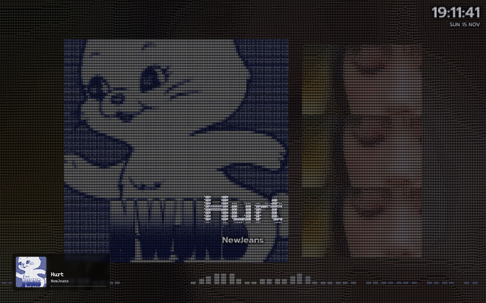
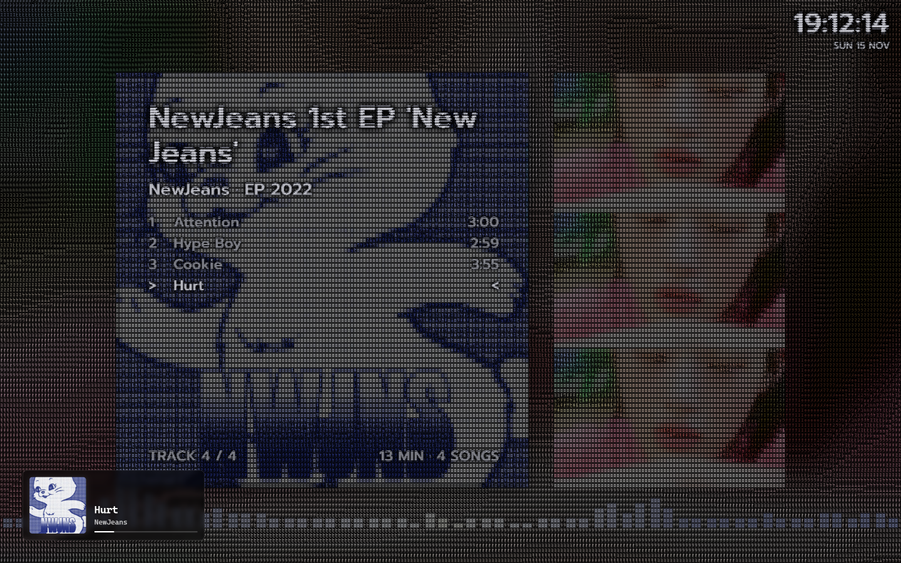
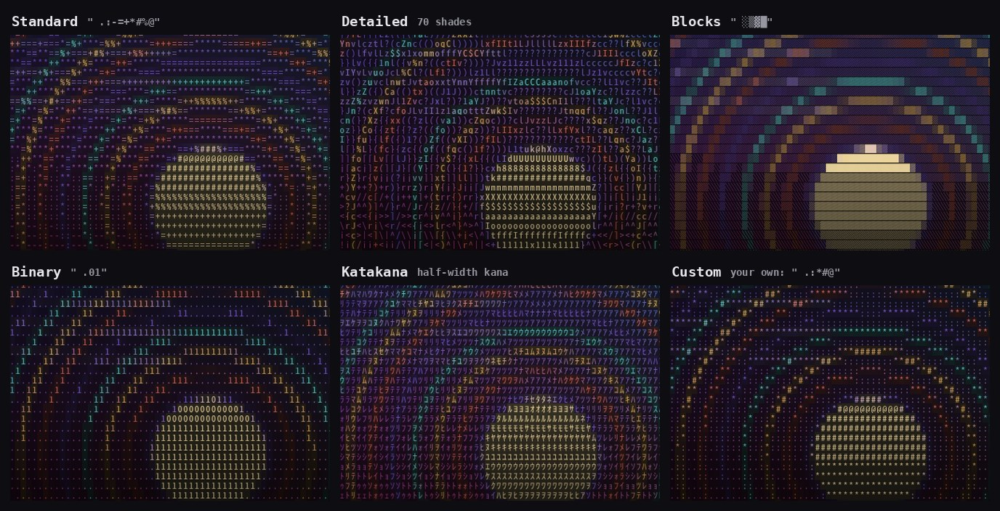
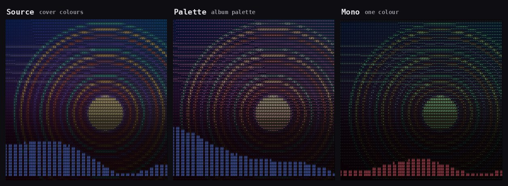
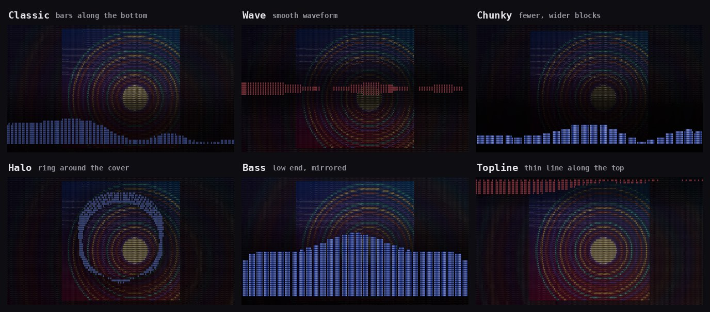
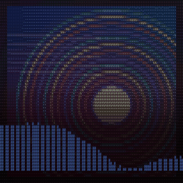
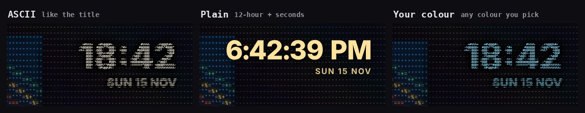

# ASCII Music Visualizer

A music visualizer wallpaper for [Wallpaper Engine](https://www.wallpaperengine.io/) that turns whatever you're listening to into live ASCII art.





*NewJeans (뉴진스) 'Hurt'*

## Features

- **Live ASCII filter:** the album cover is drawn as characters in real time by a WebGL shader, with selectable character sets, colors and cell size.
- **Audio-reactive bars:** several presets (classic, wave, halo, bass…), album-palette colors, and full manual control.
- **Spinning cover:** spins when a song starts, can be dragged and flicked, and drifts slowly when you're idle. The back shows the album's tracklist with the playing song highlighted.
- **Big ASCII song title:** the title is set in a real font and then turned into fine ASCII, so Thai and other scripts work too.
- **Synced lyrics (optional):** the current line in the same ASCII style as the title, with the next line underneath. Uses the helper and Spicetify bridge, off by default.
- **Clock:** ASCII or plain style, 12/24-hour time, seconds and date, any corner, with its own color.
- **Custom text:** mix your own words with `{title} {artist} {album} {year} {track} {tracks} {time} {albumtime} {label} {genre}`… for the title, card and back of the cover.
- **Colors:** follow the album cover, or pick your own.
- **Works without setup:** cover art and song info come from Wallpaper Engine's media integration, and tracklists are looked up on Deezer or iTunes.

## A closer look

### Character sets

Pick the characters the picture is drawn with, or type your own.



### Color modes



### Bar styles

Presets for the audio bars. Every one can be fine-tuned, or build your own with the Custom preset.



### The cover flips

It spins when a song starts, you can drag and flick it, and the back shows the album's tracklist with the playing song marked.



### Clock



## Install

Get the wallpaper from the **Steam Workshop** (search "ASCII Music Visualizer" in Wallpaper Engine's Workshop tab) and subscribe. Then turn on **media integration** in Wallpaper Engine's settings (Settings → General) and play music in Spotify or any app that shows in the Windows media controls.

That's all you need. The rest of this repo is the wallpaper's source code plus the optional helper.

### Manual install (for development)

1. Download the latest release zip (or clone this repo).
2. Copy the `wallpaper` folder to
   `…\steamapps\common\wallpaper_engine\projects\myprojects\` and rename it, for example to `ascii-music-visualizer`.
3. Restart Wallpaper Engine. The wallpaper shows up under **Installed**.
4. Turn on **media integration** in Wallpaper Engine (Settings → General) and play some music.

Every option is in the wallpaper's settings panel on the right in Wallpaper Engine.

## Optional: the local helper

The wallpaper works on its own. The helper is a small Node.js program, with no dependencies, that runs only on your own computer (`127.0.0.1`). It adds:

- modern Thai fonts (Anuphan, Noto Sans Thai, IBM Plex Sans Thai, Kanit, Prompt), downloaded once from the Google Fonts repository
- exact tracklists straight from Spotify, if you use the Spicetify bridge
- Spotify Canvas videos, together with the Spicetify bridge (unofficial, see below)

**Run it:**

1. Install [Node.js](https://nodejs.org) 18 or newer.
2. Double-click `helper/start-helper.bat`, then open http://127.0.0.1:7777 to see its status.

**Start it automatically:** double-click `helper/install-autostart.bat`. The helper then starts hidden every time you sign in to Windows and writes its log to `helper/helper.log`. Run `helper/remove-autostart.bat` to undo it.

**Settings:** copy `helper/config.example.json` to `helper/config.json` and edit it.

## Spotify Canvas videos (unofficial)

> **Read this first.** Spotify Canvases are fetched through Spotify's **private, undocumented API** and the [Spicetify](https://spicetify.app) client mod. Neither is endorsed by Spotify. They may stop working at any time, and using them may go against [Spotify's Terms of Use](https://www.spotify.com/legal/end-user-agreement/). You use this feature **at your own risk**.

To get canvases:

1. Run the helper (see above). Canvases are on by default.
2. Install the bridge into Spotify: run `spicetify/install-bridge.bat`. It installs Spicetify if needed and asks you first.
3. The wallpaper shows the canvas next to the cover. Change or turn off the layout under **Spotify Canvas** in the wallpaper settings.

To turn canvases off completely, set `"enableCanvases": false` in `helper/config.json` and restart the helper.

**Lyrics** come through the same route: turn on **Show lyrics** in the wallpaper settings and the bridge fetches Spotify's synced lyrics for the current song. They are kept in memory for that song only. Set `"enableLyrics": false` in `helper/config.json` to never fetch them.

Spotify canvases are H.264 videos, which Wallpaper Engine's browser can't play. The helper converts them to WebM with ffmpeg. If ffmpeg isn't installed, the helper downloads the official LGPL build from [BtbN/FFmpeg-Builds](https://github.com/BtbN/FFmpeg-Builds) once and checks its SHA-256 against the release's published checksums before using it.

## Privacy

- **To Deezer / iTunes:** with "Find tracklists online" on (the default), the wallpaper sends the current song's title, artist and album name to the public [Deezer API](https://developers.deezer.com/api) and, if Deezer has no match, to the [iTunes Search API](https://performance-partners.apple.com/resources/documentation/itunes-store-web-service-search-api/). Turn it off in the wallpaper settings to send nothing.
- **To the helper:** the wallpaper also sends now-playing info to the helper on your own computer only.
- **Spotify login:** the helper's optional Spotify login uses the official OAuth PKCE flow. Tokens are stored only in `helper/data/` on your computer.
- **No tracking:** no analytics, no telemetry, and no servers run by this project.
- **Non-commercial:** this project is free. The Deezer API it uses allows non-commercial use only.

## Security

- The helper listens on `127.0.0.1` only.
- It accepts requests only from the wallpaper, the Spicetify bridge and its own status page. It checks the `Host` and `Origin` headers, so other websites can't read or spoof it (including DNS-rebinding tricks).
- Every remote URL it downloads is checked against a fixed list of known image and video hosts. Track IDs and file names are validated.
- Found a problem? See [SECURITY.md](SECURITY.md).

## How it works

```
wallpaper/   Wallpaper Engine web wallpaper (HTML/CSS/JS, WebGL)
  js/ascii.js     WebGL renderer: composite canvas → one pixel per character cell → glyph atlas
  js/main.js      layout, cover flip, bars, ASCII title/clock/back-cover text, settings
  js/albums.js    tracklist lookup (Deezer → iTunes) from the page via JSONP
  js/media.js     Wallpaper Engine media/audio listeners, optional helper connection
helper/      optional local Node.js helper (zero dependencies)
spicetify/   optional Spotify client extension for the helper
```

The ASCII effect draws the whole scene to a small canvas with one pixel per character. A fragment shader then picks a glyph for each cell from an atlas sorted by ink density. Titles, the clock and the back of the cover are set in a real font first, then sampled into a finer character grid, so they keep their shape in any language.

## Disclaimer

This is an independent fan project. It is not affiliated with, endorsed by or sponsored by Spotify, Deezer, Apple, Wallpaper Engine or Valve. All trademarks belong to their owners. Album artwork and song information are shown live from your own music player and the services above.

## License

[MIT](LICENSE). Third-party software and services: see [THIRD_PARTY_NOTICES.md](THIRD_PARTY_NOTICES.md).
